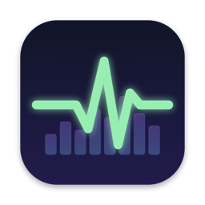
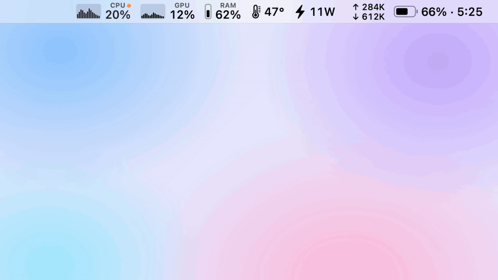
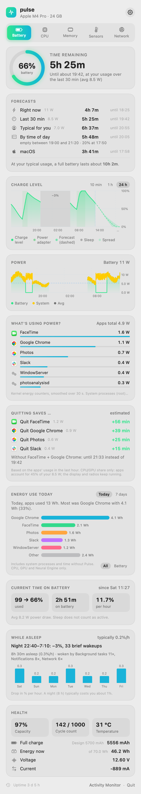
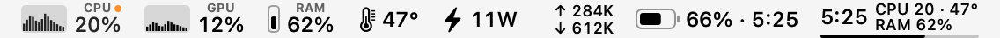
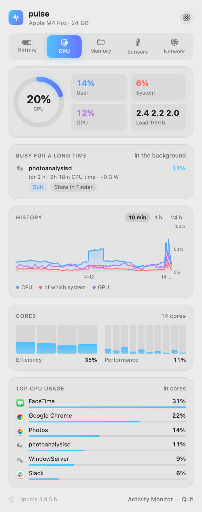
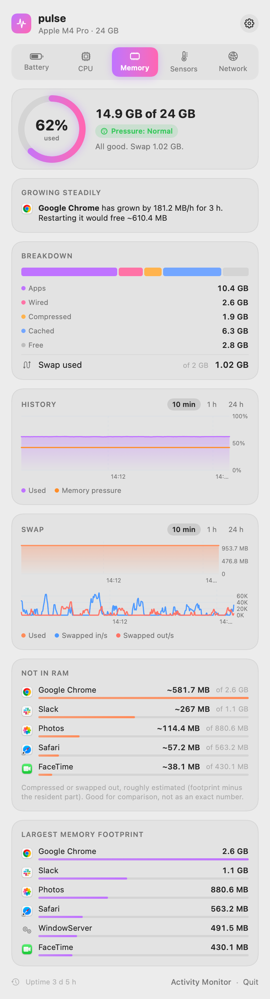
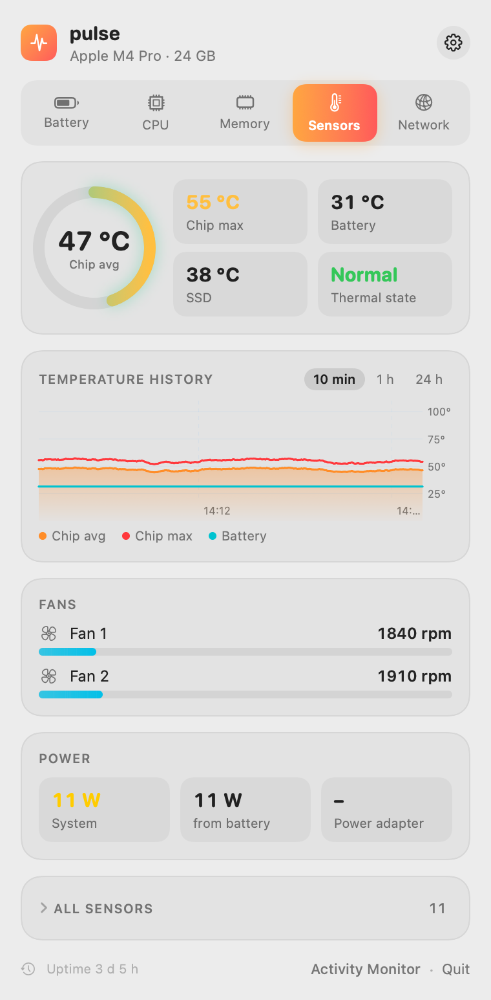

# Pulse

How your Mac is doing, in the menu bar. Battery, CPU, GPU, memory, temperatures, network, and disk for macOS.



Pulse puts your Mac's vitals in the menu bar and answers the question behind each number with one click:

- **How long will the battery last?** Forecasts from your own usage, not the macOS estimate that jumps with every spike, and which app to quit for more time.
- **What is slowing the Mac down?** Per-core load, and apps that have been busy in the background for a long time.
- **Where did the memory go?** Memory pressure, apps that grow steadily, and how much of each app is swapped out.
- **Is it running hot?** Chip temperature, throttling, and fans.
- **Who is using the network?** Rates per app, with history.

Everything runs on your Mac, without admin rights or a helper process.

Requires macOS 14 (Sonoma) or later on Apple silicon.

## Install

```
brew install --cask FlorianRiquelme/tap/pulse
```

Then start it once:

1. Open Pulse from `/Applications`, or run `open -a Pulse`. It has no Dock icon and appears in the menu bar.
2. Click any Pulse icon to open the panel.
3. To have it start with your Mac, click the gear in the panel and turn on **Launch at login**.

The app is not notarized by Apple, because that needs a paid developer account. The cask removes the quarantine flag after install so macOS opens it without complaint. If you download the zip from [Releases](https://github.com/FlorianRiquelme/pulse/releases) instead, remove the flag yourself:

```
xattr -dr com.apple.quarantine /Applications/Pulse.app
```

## Battery



Pulse shows five forecasts side by side:

- **Right now**, from the smoothed current power draw.
- **Last 30 min**, from what the battery actually lost in your last 30 minutes on battery. This is the main number in the panel and the menu bar.
- **Typical for you**, from your median draw on battery over the last 7 days, including how long a full charge lasts for you.
- **By time of day**, from your draw per hour of the day, with weekdays and weekends kept apart. It shows the spread, for example "empty between 17:20 and 18:40", as a band around the dashed forecast in the chart.
- **macOS**, the system's own estimate, for comparison.

Under the forecasts:

- **What's using power?** shows each app's draw in watts, from the kernel's energy counters. Helper processes count toward their app.
- **Quitting saves …** shows, per app, how much longer the battery would last without it, for example "Quit Slack +12 min".
- **Energy use today** shows watt-hours per app for today or the last 7 days, from the macOS powerlog. It includes system processes and the time Pulse was not running.
- **Keeping the Mac awake** lists apps that have prevented sleep for at least 10 minutes, with the real app name instead of a system daemon.
- **While asleep** shows what sleep cost, for example "Night 21:21–06:24: −2%, 46 brief wakeups", and who woke the Mac.
- **Health** shows capacity, cycle count, temperature, voltage, current, and the power adapter.

The charge chart covers 10 minutes, 1 hour, or 24 hours. It draws the forecast as a dashed line and sleep as grey bands. On first launch, Pulse fills about 5 days of battery history from the macOS powerlog, so the forecasts work right away.

## Menu bar



Each icon can be turned on or off: CPU with a mini graph, GPU, memory, temperature, power in watts, network, and battery as percent, time left, or "until 17:40". A click opens the panel on the matching section. Hold ⌘ to drag the icons to a new position.

On a MacBook with a notch, space is short, and macOS hides whatever does not fit without telling you. **Compact** puts everything into one icon of about 85 pt: time left in large type, CPU and temperature above memory, and a thin charge bar below. The settings suggest it when the separate icons take up a lot of room.

The menu bar stays monochrome like the system icons. Color appears only when something needs you: memory pressure, throttling, above 90 °C, battery below 20%, or less than an hour left.

## CPU, memory, sensors, network

<p>



</p>

- **CPU** shows user and system load, GPU, every core with efficiency and performance cores apart, and the apps with the most load. **Busy for a long time** flags apps that have used more than about 8% CPU in the background for over 10 minutes, with **Quit** and **Show in Finder**.
- **Memory** shows usage as Activity Monitor counts it, memory pressure, and the largest apps. **Not in RAM** estimates per app how much is compressed or swapped out. **Growing steadily** flags an app whose memory has grown for over an hour, for example "Slack has grown by 200 MB/h for 3 h. Restarting it would free ~600 MB".
- **Sensors** shows chip temperature (average and maximum), battery and SSD temperature, thermal state, fans or "passively cooled", system power, and every sensor on request.
- **Network** shows download and upload with history, which app is using the network, and the IP address. Disk shows free space and read and write rates.

History covers 10 minutes live, 1 hour, and 24 hours. Pulse stores one average per minute for 8 days in `~/Library/Application Support/Pulse/minutes.jsonl`.

## Where the numbers come from

| Value | Source |
| --- | --- |
| CPU per core | `host_processor_info` tick deltas, core types from `hw.perflevel*` |
| Memory | `host_statistics64`, `kern.memorystatus_vm_pressure_level`, `vm.swapusage` |
| Battery | IORegistry `AppleSmartBattery` |
| Temperatures | HID event system (private `IOHIDEventSystemClient` functions via `dlsym`) |
| Fans, system power | SMC, read only |
| GPU | IORegistry `IOAccelerator` `PerformanceStatistics` |
| Apps: CPU, memory, energy | `proc_pid_rusage` (`ri_energy_nj`), grouped by responsible process |
| Energy per app, today and 7 days | powerlog `CurrentPowerlog.PLSQL` and archives, read only, when the panel opens |
| Network | `nettop -P -L 1`, once per sample |
| Sleep | `NSWorkspace` sleep and wake notifications, brief wakeups from `pmset -g log` |
| Disk | volume capacity, IORegistry `IOBlockStorageDriver` |
| Battery history before Pulse | powerlog `BatteryLife` database, read only, else `pmset -g log` |

The powerlog is private and undocumented. If it is missing or its layout changes, Pulse falls back to `pmset -g log` without telling you.

Closed, Pulse uses about 0.5 s of CPU per minute. It builds the panel only when you open it. Processes of other users, such as root, are not readable without admin rights and are missing from **What's using power?**.

## Build from source

You need macOS 14 and Swift 5.10 or later, from Xcode or the Command Line Tools.

```
scripts/build.sh
```

`build.sh` builds a release binary, assembles and signs `build/Pulse.app`, and installs it to `~/Applications`. `scripts/test.sh` runs the test suite.

`Pulse --snapshot=<folder> [--dark]` renders every section and the menu bar to PNG files and quits. `Pulse --open --section=cpu` opens the panel on a section after launch.

## License

[MIT](LICENSE)
